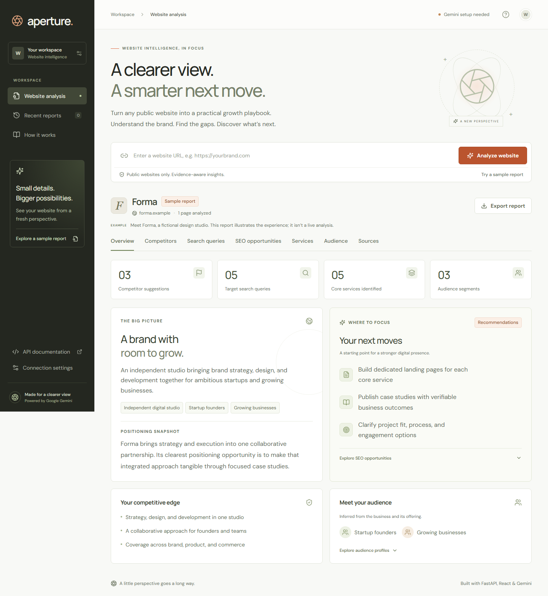
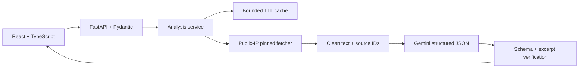

<p align="center"><strong>A P E R T U R E</strong></p>
<h1 align="center">A clearer view. A smarter next move.</h1>
<p align="center">Evidence-aware website intelligence · FastAPI + React + Google Gemini</p>

[](https://github.com/Rohit-998/Dxora/actions/workflows/ci.yml) · [Model research](docs/llm-research.md) · [Deployment](docs/deployment.md) · [Architecture](docs/architecture.md)

Turn a public website into a practical business research report. Aperture extracts real HTML, asks Gemini for structured analysis, checks service excerpts against the source text, and presents the results in a responsive React workspace.

Built for the **Dxora Python Practical Test — AI-Powered Website Link Analysis API**. The required endpoint is `POST http://localhost:4000/link-analysis`.



## Features

| Assignment section | Implementation |
| --- | --- |
| Competitor vs. brand | Brand overview, products, advantages, positioning opportunities, and named competitor suggestions with strengths/gaps labeled unverified |
| Five target queries | Exactly five distinct queries covering Google, Facebook, Instagram, LinkedIn, and X, each with intent, relevance, and audience |
| SEO improvements | Primary/secondary/long-tail/business keywords, title and meta description, prioritized content ideas, and six observable HTML checks |
| Top services | Up to five products/services, customer, industry, benefit, exact source excerpts, and observed/inferred labels |
| Target audience | Primary/secondary audiences, industries, business types, geography, needs, interests, and marketing segments |

The UI includes platform filtering, source inspection, copyable SEO text, JSON export, session history, mobile navigation, keyboard-operable tabs, and error/cancellation states. Fonts are self-hosted. No search volumes, rankings, or numerical SEO scores are invented.

**Sample versus live:** the initial Forma report is a hand-authored, fictional demonstration based on `examples/forma.html`. It is labeled as a sample, consumes no credits, and is never a fallback for failed live requests. Live Gemini output and public deployment require the user's API key and hosting account and have not yet been verified.

## Quick start

Requires **Python 3.12+** and **Node.js 22.12+** (Node 24 recommended).

```bash
git clone https://github.com/Rohit-998/Dxora.git
cd Dxora
python -m venv .venv
```

Windows PowerShell:

```powershell
.\.venv\Scripts\Activate.ps1
Copy-Item .env.example .env
```

macOS / Linux:

```bash
source .venv/bin/activate
cp .env.example .env
```

Set `GEMINI_API_KEY` in `.env` using your [Google AI Studio key](https://aistudio.google.com/api-keys), then start the API:

```bash
pip install -r requirements.txt
uvicorn app.main:app --host 0.0.0.0 --port 4000
```

API docs: [localhost:4000/docs](http://localhost:4000/docs). Health/configuration: [localhost:4000/health](http://localhost:4000/health). Without a key, the API starts and returns `503 not_configured` for live analysis. Restart it after changing `.env`. Never put the Gemini key in React or a `VITE_*` variable.

Start React in a second terminal:

```bash
cd frontend
npm ci
npm run dev
```

Open [localhost:5173](http://localhost:5173). Vite proxies API requests to port 4000. The sample works without a key.

For a **production build served by FastAPI**:

```bash
cd frontend
npm run build
cd ..
uvicorn app.main:app --host 0.0.0.0 --port 4000
```

The UI and API share [localhost:4000](http://localhost:4000). Start/restart FastAPI **after** building so it mounts `frontend/dist`. Alternatively, after creating `.env`, run `docker compose up --build`.

## API examples

macOS / Linux:

```bash
curl -X POST http://localhost:4000/link-analysis \
  -H 'Content-Type: application/json' \
  -d '{"url":"https://www.python.org/"}'
```

PowerShell:

```powershell
Invoke-RestMethod -Method Post -Uri http://localhost:4000/link-analysis `
  -ContentType 'application/json' `
  -Body '{"url":"https://www.python.org/"}'
```

The successful response has `success`, `website`, `brand`, `analysis`, `limitations`, `sources`, `seo_checks`, and `metadata`. The `analysis` object contains `competitor_analysis`, `target_search_queries`, `seo_improvements`, `top_services`, and `target_audience`.

See the **[full validated sample JSON](examples/sample-response.json)** and `/openapi.json` for complete fields. Metadata reports model, generation time, duration, cache status, request ID, page count, and provider-reported token usage when available.

Errors have a consistent shape:

```json
{
  "success": false,
  "error": {
    "code": "not_configured",
    "message": "Add GEMINI_API_KEY to the server .env to run live analysis.",
    "request_id": "a-unique-request-id"
  }
}
```

| Status | Meaning |
| --- | --- |
| 401 | Missing/invalid optional app access key |
| 413 | Request exceeds 4 KB |
| 422 | Invalid URL/body, private destination, unreadable/oversized/non-HTML page |
| 429 | Local request limit; includes `Retry-After` |
| 502 | Gemini unavailable, malformed output, or incomplete response |
| 503 | Key missing, provider authentication/quota failure, or busy server |
| 504 | Fetch or model deadline exceeded |

If `ANALYSIS_API_KEY` is configured, send `X-API-Key: <app-access-key>` or enter it in the UI's **Connection settings**. This is separate from the Gemini key and is not persisted by the browser.

## Engineering



- **Boundaries:** HTTP layer, orchestration, URL policy, extraction, and Gemini integration are independent modules with injectable I/O.
- **SSRF protection:** only HTTP(S)/standard ports; reject credentials/internal names; validate all DNS answers and redirects; reject non-public/transition IPs; connect to the checked IP while preserving Host and TLS hostname verification. Proxy environment settings are ignored.
- **Resource budgets:** 3 pages, 2 MB per HTML response, 24,000 extracted characters, 4 redirect hops, 15 seconds per fetch, 75 seconds for Gemini including one transient retry, and 3 concurrent analyses by default. Compressed responses are refused to bound decompression risk.
- **Evidence:** website text is treated as untrusted input. Strict Pydantic models validate output. Unmatched service citations are removed and labeled inferred. A matched quotation establishes presence in the source, not independent truth or semantic correctness.
- **Cost/reliability:** bounded 15-minute cache, duplicate coordination, sanitized errors, request IDs, optional authentication, and per-client throttling.
- **Secrets:** ignored `.env`, backend-only provider key in a header, no raw provider bodies or URLs in application logs, and no secrets in container images.

See [architecture and tradeoffs](docs/architecture.md). Cache and throttling are per-process; multiple replicas need shared storage and edge controls. Add an egress firewall in production. The extractor does not execute JavaScript, bypass access restrictions, or audit an entire website.

## LLM comparison and recommendation

Checked **21 November 2026**. Standard text prices are USD per million tokens. Speed/accuracy are not benchmarked here.

| Provider/model | Input / output | Context | JSON | Assessment |
| --- | --- | --- | --- | --- |
| **Gemini 3.5 Flash-Lite** | **$0.30 / $2.50** | 1,048,576 input | Schema-constrained | Selected for the requested Gemini integration and bounded extraction workload |
| Gemini 3.8 Flash | $0.75 / $3.75 until 31 Dec 2026 | 1M | Schema-constrained | Manual quality-oriented alternative; $1.50 / $7.50 from 1 Jan 2027 |
| GPT-6.1 Terra | $1.00 / $5.00 | 1,050,000 | Structured outputs | Cross-provider candidate; separate adapter required |
| Claude Haiku 5.5 | $0.10 / $0.50 at ≤100K input | 1M | Provider documents JSON schema | Cheapest short-prompt candidate listed; not implemented/benchmarked |

Sources: [Google pricing](https://aistudio.google.com/docs/pricing), [Gemini specifications](https://aistudio.google.com/docs/models/gemini-3.5-flash-lite), [OpenAI](https://developers.openai.com/api/docs/models/gpt-6.1-terra), [Anthropic](https://platform.claude.com/docs/en/models/haiku-5-5/overview).

**Recommendation:** `gemini-3.5-flash-lite`, minimal thinking. Estimated **8,000 input + 3,500 output tokens = $0.01115** before thinking/retries. Plan for **10–40 seconds generation**, **15–60 seconds typical uncached end-to-end**, as estimates only. Actual times depend on websites, output length, provider load, and quota. The API reports actual provider token counts when supplied.

Use `gemini-3.8-flash` as a manually configured alternative after evaluation. No hidden fallback spending is implemented. We do not claim maximum accuracy or that Gemini is cheapest. The [full research note](docs/llm-research.md) covers lifecycle changes, pricing, cost controls, and a reproducible evaluation plan.

## Verification

```bash
pip install -r requirements-dev.txt
ruff check app tests scripts
ruff format --check app tests scripts
pytest --cov=app --cov-report=term-missing
```

```bash
cd frontend
npm ci
npm run build
npx playwright install chromium
npm run test:e2e
```

Backend tests cover the API contract, SSRF/redirect policy, pinning, extraction, Gemini payloads, failures, evidence, caching, and throttling. Browser tests mock the network boundary and spend no credits. These are software tests, not live model benchmarks.

GitHub Actions runs Python checks, the production frontend build, Chromium tests, and Docker build/HTTP smoke tests. [Verification notes](docs/verification.md) record results and limitations.

## Project map

```text
app/main.py                   HTTP endpoints, middleware, lifecycle
app/config.py                 Environment settings
app/schemas.py                Request/report/error contracts
app/services/url_policy.py    URL + public-IP validation
app/services/website_extractor.py  Fetching, extraction, HTML checks
app/services/llm_service.py    Gemini + excerpt verification
app/services/analysis_service.py   Cache and orchestration
frontend/src/                 React workspace and report panels
frontend/e2e/                 Browser tests
tests/                        Backend tests
examples/                     Fictional HTML + full sample JSON
docs/                         Research, deployment, screenshots
scripts/                      Sample generator and smoke check
Dockerfile                    Non-root Python + React production image
render.yaml                   Render Blueprint
```

## Deploy and submit

[](https://render.com/deploy?repo=https://github.com/Rohit-998/Dxora)

Follow the [deployment guide](docs/deployment.md), add the Gemini key, and verify a live report. A public hosting URL still requires an actual deployment. The Blueprint enables an app access key to protect provider quota; share that separate key with reviewers or deliberately disable it for an open demo.

The [submission checklist](docs/submission-checklist.md) lists the actual demo URL, `/docs`, personal details, and profile links needed for the assignment. This project does not send an application email or perform social-media actions.
